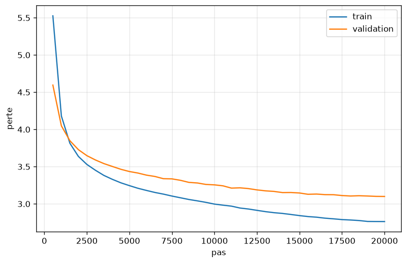

# mini-gpt

Un GPT écrit **entièrement from scratch en PyTorch** : tokenizer BPE niveau octet, attention multi-têtes, transformer décodeur de 19 M de paramètres, boucle d'entraînement, génération. LoRA et GRPO suivront.

## Pourquoi ce projet

Comprendre les mathématiques des LLM en les implémentant moi-même, sans `nn.Linear` ni `nn.MultiheadAttention` : chaque formule (attention, normalisation, perte, gradient) est codée à la main et vérifiée par des tests.

## État du projet

- [x] Tokenizer BPE niveau octet (entraîné sur le corpus d'entraînement uniquement)
- [x] Nettoyage du corpus et pipeline de données (binaires `uint16`, `get_batch`)
- [x] Attention multi-têtes causale
- [x] Transformer de 19 M de paramètres (pre-norm, RMSNorm, MLP GELU)
- [x] Entraînement AdamW (warmup + cosine, gradient clipping), validation, sauvegarde du meilleur checkpoint
- [x] Génération de texte (température, top-k, arrêt sur `<|eot|>`)
- [x] Évaluation finale sur un livre de test jamais utilisé
- [ ] LoRA (adaptation au style de Victor Hugo)
- [ ] GRPO

## Résultats

### Évaluation finale (meilleur checkpoint, pas 20 000)

| Ensemble | Livre | Tokens évalués | Perte | Perplexité | Car./token | Bits/car. |
|---|---|---|---|---|---|---|
| Validation | *Quatrevingt-treize* (Hugo, 1874) | 205 568 | 3,108 | 22,4 | 3,33 | 1,344 |
| **Test** | ***Notre-Dame de Paris*** (Hugo, 1831) | 142 848 | **3,195** | **24,4** | 3,38 | **1,363** |

- Le livre de test n'a servi à **aucune décision** : il est exclu de l'entraînement du modèle et de celui du tokenizer, et le choix du checkpoint comme celui des hyperparamètres se sont faits sur la validation. L'écart val → test est faible (+0,09 en perte), ce qui indique que la sélection sur la validation n'a pas biaisé le résultat.
- **Perplexité** = exp(L), où L est la perte d'entropie croisée moyenne par token.
- **Bits par caractère** = L / (ln 2 · c), où c est le nombre moyen de caractères par token, mesuré sur chaque livre. Cette métrique permet de comparer des modèles ayant des tokenizers différents, ce qui n'est pas possible avec la perplexité.
- **Méthode** : fenêtres consécutives de T = 256 tokens, sans chevauchement. Chaque token est donc prédit avec en moyenne 128 tokens de contexte seulement, et ces chiffres sont légèrement pessimistes par rapport à une évaluation en fenêtre glissante.

### Courbe d'entraînement

20 000 pas, soit 164 M tokens vus (≈ 4,3 époques). Perte finale : train ≈ 2,76, validation 3,099 (mesurée pendant l'entraînement sur 25 batchs fixes).



La validation baisse jusqu'à la fin de l'entraînement, très lentement vers la fin quand le learning rate atteint son minimum : pas de surapprentissage. L'écart train/val (environ 0,34) vient en partie de la validation, qui est un seul livre au style différent de la moyenne du corpus. Le modèle voit environ 9 tokens par paramètre, sous le rapport d'environ 20 de la loi de Chinchilla : il est limité par le calcul, pas par les données.

### Exemple de génération (température 0,7, top-k 20)

> Il s'appelait Jean Valjean. Il sortit de la prison un matin d'octobre, et il marcha vers la prison, noya dans le corridor et se réfugia devant lui.
>
> Chapitre VI
>
> Le jardin
>
> L'homme qui avait une porte en face de ces deux hommes était dans l'angle de la salle. [...]

Le modèle maîtrise la syntaxe, la ponctuation, les dialogues (`--`) et la structure d'un roman (chapitres, titres). Il garde une cohérence locale mais pas une cohérence d'intrigue sur plusieurs phrases, ce qui est attendu pour 19 M de paramètres et un contexte de 256 tokens.

## Corpus et pipeline de données

**Corpus** : environ 139 Mo de textes français du XIXᵉ siècle (172 fichiers : romans, poésie, théâtre, mémoires, discours), issus de Project Gutenberg, Wikisource et la Bibliothèque électronique du Québec.

### Découpage en train / validation / test

Le découpage se fait **par livre** : aucun passage d'un livre de validation ou de test n'apparaît dans l'entraînement, ni dans celui du tokenizer.

| Ensemble | Contenu | Auteur(s) | Tokens |
|---|---|---|---|
| **Train** | 170 fichiers (tous sauf les deux ci-dessous) | 19 auteurs | 37 894 646 |
| **Validation** | *Quatrevingt-treize* (1874) | Victor Hugo | 205 748 |
| **Test** | *Notre-Dame de Paris* (1831) | Victor Hugo | 143 037 |

La validation et le test sont des **livres jamais vus**, mais pas des **auteurs jamais vus** : les 33 autres fichiers de Hugo sont dans le train.

### Composition du train (170 fichiers)

| Auteur | Fichiers | Œuvres principales |
|---|---|---|
| Victor Hugo | 33 | Les Misérables, L'Homme qui rit, Les Travailleurs de la mer, Les Contemplations, La Légende des siècles, Les Châtiments, Han d'Islande, Hernani, Ruy Blas, Actes et paroles, Choses vues, Le Rhin (hors *Quatrevingt-treize* et *Notre-Dame de Paris*) |
| Alexandre Dumas | 28 | Les Trois Mousquetaires, Vingt ans après, Le Vicomte de Bragelonne, Le Comte de Monte-Cristo, La Reine Margot, La Dame de Monsoreau, Joseph Balsamo |
| Émile Zola | 20 | Germinal, L'Assommoir, Nana, La Bête humaine, Au Bonheur des Dames, La Débâcle, Thérèse Raquin |
| Honoré de Balzac | 18 | La Comédie humaine (18 volumes) |
| Chateaubriand | 10 | Mémoires d'outre-tombe, Atala, René, Génie du christianisme, Les Martyrs |
| Eugène Sue | 10 | Les Mystères de Paris, Le Juif errant, Atar-Gull, La Salamandre |
| George Sand | 9 | Consuelo, La Mare au diable, La Petite Fadette, Indiana, Mauprat |
| Guy de Maupassant | 8 | Bel-Ami, Une vie, Pierre et Jean, Contes de la bécasse |
| Gustave Flaubert | 6 | Madame Bovary, L'Éducation sentimentale, Salammbô, Bouvard et Pécuchet |
| Alphonse Daudet | 5 | Tartarin de Tarascon, Le Petit Chose, Lettres de mon moulin |
| Stendhal | 5 | Le Rouge et le Noir, La Chartreuse de Parme, Lucien Leuwen |
| Théophile Gautier | 4 | Le Capitaine Fracasse, Mademoiselle de Maupin, Le Roman de la momie |
| Paul Féval | 3 | Le Bossu, Les Habits noirs, Les Mystères de Londres |
| Lamartine | 3 | Graziella, Histoire des Girondins, Les Confidences |
| Gérard de Nerval | 2 | Aurélia, Les Filles du feu |
| Prosper Mérimée | 2 | Colomba, Chronique du règne de Charles IX |
| Alfred de Vigny | 2 | Cinq-Mars, Servitude et grandeur militaires |
| Mme de Staël | 1 | Corinne |
| Alfred de Musset | 1 | La Confession d'un enfant du siècle |

Les effectifs sont en nombre de fichiers (volumes ou tomes), pas en tokens : un volume de *La Comédie humaine* pèse beaucoup plus qu'une nouvelle.

### Nettoyage (`scripts/clean_livre.py`)

- suppression des en-têtes et pieds de page Gutenberg, des colophons, des notes de transcription et des notes de bas de page Wikisource ;
- liste blanche de caractères (ASCII, lettres latines accentuées, œ, ponctuation typographique), suppression des caractères invisibles (BOM, etc.) ;
- recollage des lignes coupées en dur dans la prose, normalisation des tirets de dialogue (`--`) et de l'espacement avant `? ! ; :`.

### Format des données

- Chaque œuvre est tokenisée puis terminée par `<|eot|>` (ID 6256), écrit comme **entier**, pas comme texte.
- Stockage : tableau plat `uint16`, relu avec `np.fromfile(..., dtype=np.uint16).astype(np.int64)`.
- `data/meta.json` : `{"K": 6000, "V": 6257, "N_train": 37894646, "N_val": 205748, "N_test": 143037}`.
- Le script de préparation vérifie la cohérence des fichiers (taille = 2 × nombre de tokens, tous les IDs ≤ 6256).

**`get_batch(text, B, T, device)`** tire B positions de départ aléatoires `i` et renvoie `x = text[i : i+T]` et `y = text[i+1 : i+T+1]` (décalé d'un cran : le modèle prédit le token suivant à chaque position). Cela donne B·T prédictions par pas. Le décalage est vérifié par un test (`x[:, 1:] == y[:, :-1]`).

## Tokenizer BPE

Tokenizer de type GPT-2, niveau octet : 256 octets de base + K = 6000 fusions = 6256 tokens, plus le token spécial `<|eot|>` (ID 6256). **Taille du vocabulaire : V = 6257.**

- L'entraînement est incrémental : comptage des chunks distincts avec leur fréquence, index inversé paire → mots, mise à jour des comptes de paires. Il prend quelques minutes sur 139 Mo, contre des heures avec l'implémentation naïve.
- L'encodeur applique répétitivement la fusion de plus petit rang présente, avec un cache par chunk.
- Le tokenizer est entraîné **sans** *Quatrevingt-treize* ni *Notre-Dame de Paris*.

| Tokenizer | Corpus d'entraînement | Car./token (val) | Car./token (*Germinal*) |
|---|---|---|---|
| Ancien | Hugo seul | 3,33 | 3,41 |
| Actuel | 170 fichiers, hors val/test | 3,34 | 3,51 |

*Germinal* fait partie du corpus d'entraînement du tokenizer actuel mais pas de l'ancien : la colonne de validation est la seule comparaison à armes égales.

## Architecture du modèle

Transformer décodeur, pre-norm.

| Symbole | Signification |
|---|---|
| B | taille du batch (séquences par pas) |
| T | longueur de contexte (tokens par séquence) |
| d | dimension du modèle |
| h | nombre de têtes d'attention |
| d_k = d / h | dimension par tête |
| d_ff = 4d | dimension cachée du MLP |
| V | taille du vocabulaire |
| E ∈ ℝ^{V×d} | matrice d'embedding des tokens |
| P ∈ ℝ^{T×d} | embedding de position (appris) |

**Forward** (pour une séquence de t ≤ T tokens)

1. X₀ = E[x] + P[:t]
2. Pour chaque bloc :
   - X ← X + Attention(RMSNorm(X; γ₁))
   - X ← X + MLP(RMSNorm(X; γ₂))
3. X_f = RMSNorm(X; γ_final)
4. logits = X_f · W_out, avec W_out ∈ ℝ^{d×V} (non partagé avec E)

**Attention causale** : softmax(Q Kᵀ / √d_k + masque) V, avec masque = −∞ au-dessus de la diagonale, puis projection W_O.

**MLP** : GELU(X W₁ + b₁) W₂ + b₂.

**RMSNorm** : x / √(mean(x²) + ε) · γ, où ε est une petite constante de stabilité numérique et γ un vecteur appris.

**Perte** : entropie croisée moyenne sur les B·T positions. Le gradient par rapport aux logits vaut (p − onehot) / (B·T), où p = softmax(logits).

**Configuration**

| Hyperparamètre | Valeur |
|---|---|
| B | 32 |
| T | 256 |
| d | 384 |
| h (d_k = 64) | 6 |
| Blocs | 8 |
| d_ff | 1536 |
| V | 6257 |
| Paramètres | 19 081 344 |
| Précision | fp32 |

Le nombre de paramètres est vérifié contre la formule théorique.

## Entraînement

- **Optimiseur** : AdamW (β₁ = 0,9, β₂ = 0,95), weight decay 0,1 appliqué uniquement aux paramètres de dimension ≥ 2 (pas aux γ ni aux biais).
- **Gradient clipping** : norme maximale 1,0.
- **Planning du learning rate** : warmup linéaire puis décroissance en cosinus.

  lr(s) = LR_max · s / W pour s < W, puis lr(s) = LR_min + ½ (LR_max − LR_min) (1 + cos(π (s − W) / (S − W)))

  où s est le numéro du pas, W le nombre de pas de warmup et S le nombre total de pas.

| Paramètre | Valeur |
|---|---|
| S (pas) | 20 000 |
| W (warmup) | 500 |
| LR_max → LR_min | 6e-4 → 6e-5 |

- **Évaluation pendant l'entraînement** : tous les 500 pas, sur 25 batchs de validation fixes (pour comparer les évaluations entre elles). Le meilleur checkpoint est sauvegardé.
- Un pas utilise B·T = 8192 tokens, donc une époque ≈ 4626 pas.
- Perte initiale attendue ≈ ln V ≈ 8,74.

### Étude de cas : surapprentissage du premier essai

Mon premier modèle, entraîné sur un corpus d'environ 2,2 M tokens (Hugo seul), a atteint sa meilleure validation (3,913, soit environ 1,70 bit par caractère) au pas 3250, soit environ 12 époques. Ensuite la validation est remontée pendant que le train continuait de baisser. La génération produisait alors du français bien formé mais sans sens. C'est ce qui a motivé l'agrandissement du corpus (×17) : avec 37,9 M tokens, le modèle ne surapprend plus. La comparaison avec le modèle actuel n'est qu'indicative, car le tokenizer et le jeu de données ont changé.

## Évaluation et génération

**Évaluation** (val et test, avec garde-fou) :

```bash
PYTHONPATH=src python scripts/eval_test.py checkpoints/best_19M.pt
```

Le script recalcule la perte sur chaque split complet et la compare à celle de l'entraînement, ce qui détecte une configuration incorrecte (par exemple un mauvais nombre de têtes, qui charge les poids sans erreur). Ici : 3,108 recalculé contre 3,099 à l'entraînement.

**Génération** :

```bash
PYTHONPATH=src python -m minigpt.generate
```

Le script charge le meilleur checkpoint et génère la suite d'un texte saisi au clavier. Il applique une température et un top-k, arrête la génération sur `<|eot|>` et tronque le contexte à T tokens. Commandes interactives : `/t 0.7` (température), `/k 20` (top-k), `/n 200` (nombre de tokens).

## Reproduire

```bash
python scripts/clean_livre.py          # data/raw -> data/clean
python scripts/train_tokenizer.py      # écrit data/save.json
python scripts/encode_dataset.py       # écrit data/s_{train,val,test}.bin
python scripts/meta_data.py            # écrit data/meta.json
python src/minigpt/train_llm.py        # entraîne et sauvegarde le meilleur checkpoint
PYTHONPATH=src python scripts/eval_test.py checkpoints/best_19M.pt
```

## Vérifications de correction

| Test | Résultat |
|---|---|
| Perte initiale ≈ ln V | ✅ |
| Nombre de paramètres = formule théorique | ✅ |
| Overfit d'un seul batch (perte → ~0) | ✅ (valide le flux de gradient, pas la causalité) |
| Causalité : modifier le token à la position 10 ne change pas les logits des positions < 10 | ✅ (écart = 0.0) |
| Décalage de y (`x[:,1:] == y[:,:-1]`) | ✅ |
| Tous les IDs < V dans les fichiers `.bin` | ✅ |
| Aller-retour du tokenizer (encode puis decode) sur la validation | ✅ |
| Perte val recalculée sur tout le split = perte d'entraînement | ✅ (3,108 contre 3,099) |
| Gradient de chaque paramètre non nul | à faire |

## Bugs rencontrés

1. **Paramètres non enregistrés** : les blocs étaient stockés dans une liste Python, donc invisibles pour `model.parameters()`. Corrigé avec `nn.ModuleList` de `nn.ParameterDict`.
2. **Opération in-place** : `X += A` casse l'autograd. Remplacé par `X = X + A`.
3. **Biais du MLP** : b₂ avait la taille d_ff au lieu de d.
4. **Corruption du fichier binaire** : `<|eot|>` avait été écrit comme 7 octets ASCII dans un fichier `uint16`, ce qui décalait tout et produisait des IDs hors vocabulaire. Corrigé en écrivant l'ID entier, avec des assertions de relecture.
5. **`meta.json` comptait des octets, pas des tokens** : un fichier `uint16` pèse 2 octets par token, donc tous mes effectifs étaient doublés, ainsi que le nombre d'époques que j'en déduisais. Corrigé en lisant la longueur du tableau `uint16`.
6. **Positions à la génération** : avec un prompt plus court que T, `E[x] + P` échouait (tailles 10 et 256). Corrigé avec `P[:t]` et un masque causal construit à partir de la longueur réelle de la séquence.
7. **Caractères invisibles** : les EPUB convertis contenaient des BOM (`<feff>`), des appels de notes et des colophons. Corrigé par la liste blanche de caractères du nettoyage.

## Limites connues

- **Cohérence** : cohérence locale (phrases, dialogues) mais pas d'intrigue suivie. Le modèle mélange les noms de personnages de plusieurs livres.
- **Répétitions** : à faible température (0,7), le modèle peut boucler sur un nom (« le comte »). Une pénalité de répétition est prévue.
- **Corpus** : quelques livres conservent des retours à la ligne en milieu de phrase (lignes courtes), que le modèle reproduit ; les apostrophes `’` et `'` sont mélangées.
- **Validation et test** : un livre chacun, tous deux de Hugo, dont 33 autres œuvres sont dans le train. Ils mesurent la généralisation à un livre inconnu, pas à un auteur inconnu.
- **Pas de dropout ni de weight tying** pour l'instant.

## Prochaines étapes

1. LoRA : adapter le modèle au style de Victor Hugo en n'entraînant que des matrices de rang faible B·A ajoutées aux poids gelés W (W + (α/r)·B·A).
2. GRPO : apprentissage par renforcement avec avantages calculés par groupe.
3. Pénalité de répétition, weight tying, dropout si la validation se met à remonter.
